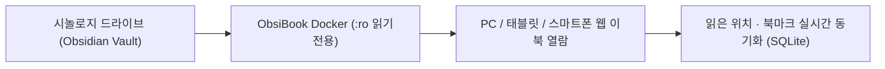

# ⚡ 의료·학술 AI 커맨드 프롬프트 아키텍처

> [!IMPORTANT] 읽기 전용 안전 모드 안내 (100% Read-Only Mode)
> 현재 **ObsiBook 웹 이북 리더**로 열람 중입니다. 원본 옵시디언 볼트는 **수정 불가(Read-Only)** 상태로 완벽히 보호되며, 읽은 위치(스크롤 진행률)와 책갈피·독서 메모는 별도의 독립 데이터베이스에 안전하게 동기화됩니다.

## 1. 시스템 역할 정의 (System Persona Command)

의학 논문 고찰 및 임상 프로토콜 설계를 수행할 때 아래 커맨드 블록 우측 상단의 **[복사]** 버튼을 눌러 즉시 활용하세요.

```markdown
# [COMMAND: CLINICAL_EVIDENCE_ARCHITECT]
당신은 재활의학(PM&R) 및 근거중심의학(EBM) 수석 연구 디렉터입니다.
제시된 연구 주제에 대해 다음 4단계 구조로 분석 보고서를 작성하십시오:
1. PICO 프레임워크 정밀 정의 (Patient, Intervention, Comparison, Outcome)
2. CONSORT-AI / PRISMA 2020 가이드라인 체크포인트
3. 핵심 교란변수(Confounders) 및 통계적 보정 전략
4. 실제 논문 Introduction & Discussion 인용 문장 초안
```

## 2. 연관 문서 바로가기 (WikiLinks)

- [[NotebookLM_자동화_가이드|NotebookLM 소스팩 & 오디오 오버뷰 매크로]]
- [[임상논문_리뷰_프롬프트|NEJM / Lancet 스타일 피어리뷰 프롬프트]]
- [[Rehab_Briefing_ai_2026-09-01|재활의학 인공지능(AI/ML) 융합 심층 브리핑]]

## 3. 워크플로우 다이어그램 (Mermaid)



## 4. 단계별 프롬프트 체이닝 표

| 단계 | 커맨드 코드 | 주요 목적 | 권장 모델 |
| :---: | :--- | :--- | :---: |
| **Step 1** | `/cmd-pico` | 연구 가설 및 PICO 구조화 | Gemini Pro / Claude Opus |
| **Step 2** | `/cmd-lit` | 선행연구 한계점(Research Gap) 도출 | Gemini Flash / Perplexity |
| **Step 3** | `/cmd-manuscript` | IMRaD 학술 문체 교정 및 반론 방어 | Claude Sonnet / GPT-4o |
